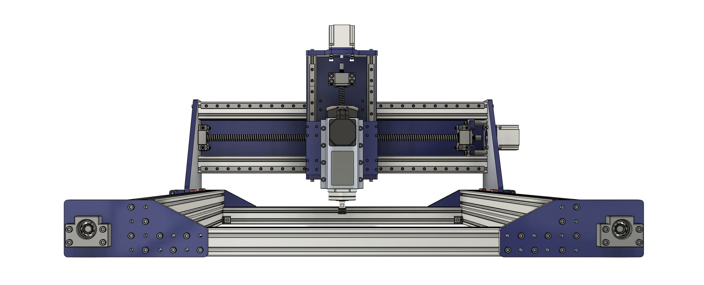

# Cindymill
**A gentle way to start CNC milling.**

Cindymill is a DIY CNC milling machine. It is supposed to be a good introduction to the world of milling. As you build the machine, you learn how it works. Cindymill is open source, so you can easily adapt it to your needs. The components are affordable, but the machine is rigid enough to comfortably mill aluminum (as well as wood and plastic, of course).

## Short Specs
- Ball screws SFU1605 on X and Y,  SFU1204 on Z.
- Extruded profile: based on 20x20 Item type.
- Rails: MGN12
- Motors: NEMA23
- Work area: 750 x 475 x 120 mm, can easily be adapted to other sizes.
- Price: approx. 1500€/$.

## Documentation

You will find all relevant information about parts and assembly on the **[Cindymill website](https://culturalheritagedigital.github.io/Cindymill/)**.

The project used to be published at `www.cindymill.xyz`. That domain has been given up — the address above is the permanent one.

## What is in this repository

Website and CAD data live side by side here:

| Path | Contents |
|---|---|
| `model/` | CAD and model data: assemblies, drawings, printable parts, tools |
| everything else in the root | Source of the website (Jekyll), built and published by GitHub Actions |

> **If you have a fork or an old link:** the model data used to sit directly in the repository root. It moved into `model/` when the website joined this repository. Git recorded the move as renames, so the history of every single file is intact — but paths from before the move need `model/` put in front of them.

## Support

If you like the project you can tip me via . Thanks.

## License

This work is licensed under a
[Creative Commons Attribution-NonCommercial-ShareAlike 4.0 International License][cc-by-nc-sa].

[![CC BY-NC-SA 4.0][cc-by-nc-sa-image]][cc-by-nc-sa]

[cc-by-nc-sa]: https://creativecommons.org/licenses/by-nc-sa/4.0/
[cc-by-nc-sa-image]: https://licensebuttons.net/l/by-nc-sa/4.0/88x31.png

Cite the project in academics: 
