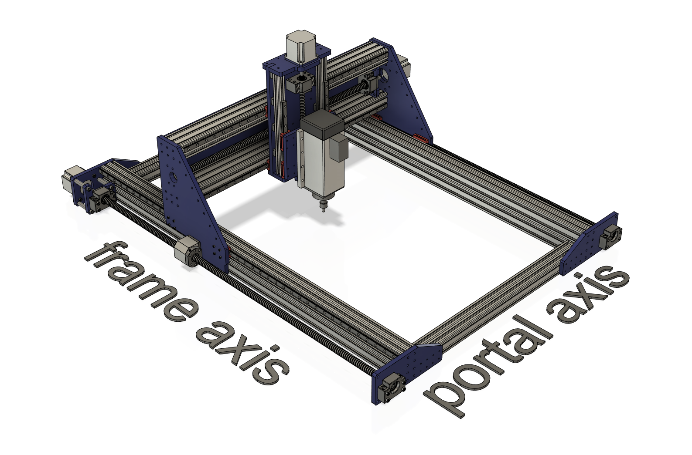
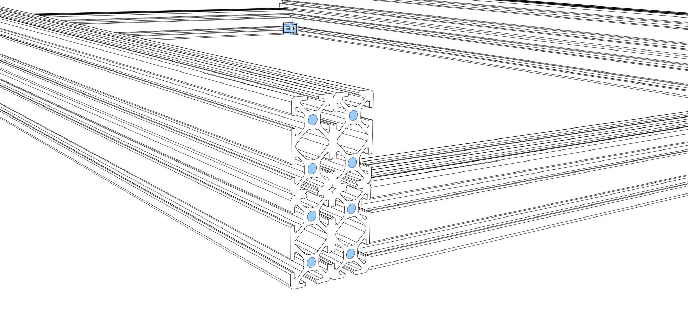
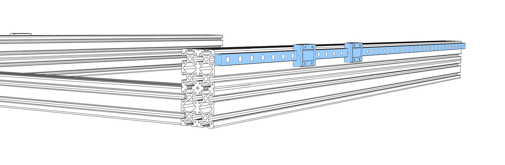
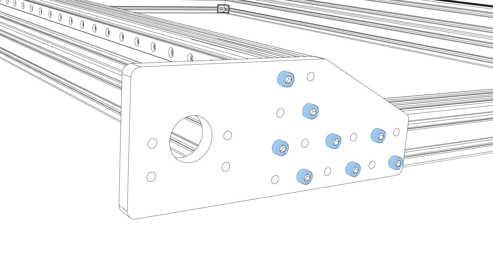
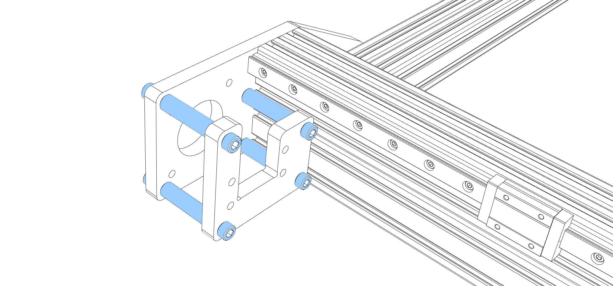
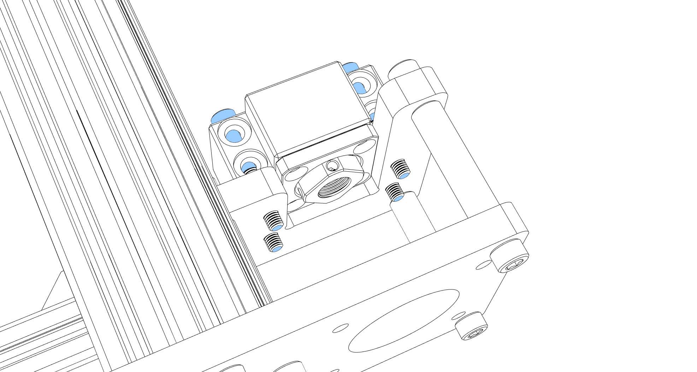
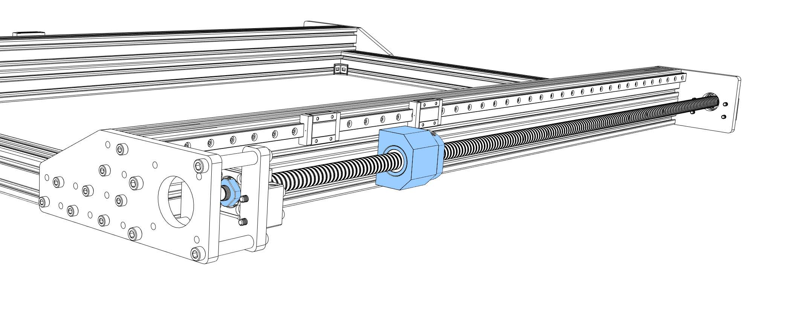
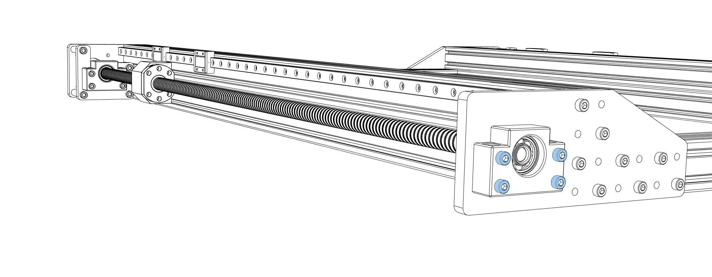
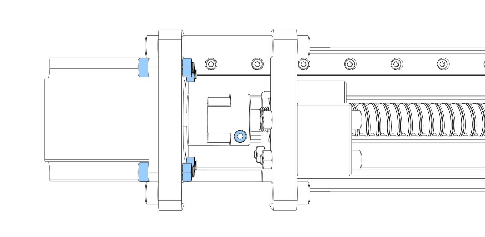
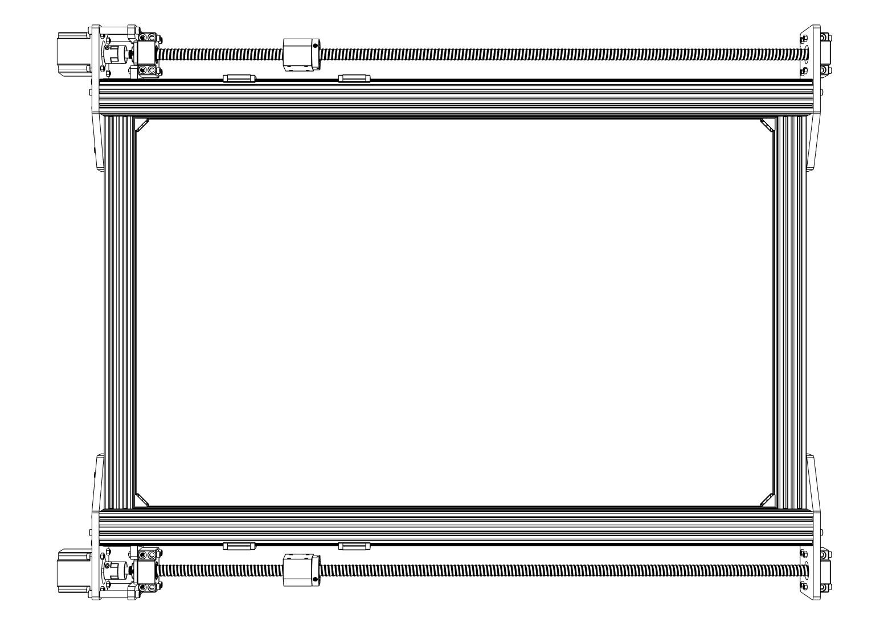

Required parts:
- Extruded profiles 2x 40x80 and 2x 40x40,
- Brackets
- 2x MGN12 rails 1000 mm
- 4x MGN12H rail blocks
- Milled plates starting with "Cindymill_Frame_.."
- 8x 40 mm steel sockets
- 2x fixed bearing block BK12
- 2x bearing block BF12
- 2x Ball screw SFU1605 1000 mm
- 2x ball nut holder
- 2x NEMA23 motor
- 2x motor coupler
- Screws and nuts (see parts list)

---
<!-- **Disclaimer:** There is often confusion about how the axes on a CNC machine are labeled. In general, the [right hand rule](https://www.autodesk.com/products/fusion-360/blog/cnc-coordinate-system-made-easy/){:target="_blank"} applies, so the designation of X and Y axes changes depending on where you set your origin. I therefore use the names as shown in the illustration below. Z is (hopefully) the same for everyone, the other directions are called "frame axis" and "portal axis" to avoid XY confusion.

--- -->

 <iframe title="Cindymill Frame" frameborder="0" allowfullscreen mozallowfullscreen="true" webkitallowfullscreen="true" allow="fullscreen; autoplay; vr" xr-spatial-tracking execution-while-out-of-viewport execution-while-not-rendered web-share width="800" height="600" src="https://sketchfab.com/models/b14c67261d234f39bf0b9cd3a46a037e/embed?autospin=1&autostart=1"> </iframe> 

---

- Start by cutting M5 threads in all ends of the 40x80 extruded profiles (approx. 15 mm depth). Arrange the 40x80 and 40x40 profiles.

- Use some brackets to roughly hold the frame in place (_loose_).

- Prepare the MGN12 rails (degrease and lubricate), put M3x8 screws and nuts in every hole of the rails, slide the rails onto the frame. Each rail has to have two rail blocks (MGN12H). Be careful when sliding the blocks onto the rails (don't loose balls).
Depending on which type of T-nuts you have you now might want to already slide some nuts into the bottom of the frame (to screw the frame onto a ground plate later). I used five screws per length. If you need attachments on the profiles (limit switches, light, cable chain,..) now is the moment to pre-install nuts into the slots (I have a few extra in each slot).

- Screw the four frame plates to the frame. You could use all the prepared holes, but half of them should already do the job. 4x M5x20 for the threaded ends (7-8 Nm max), 4x M5x15 for the slots (5 Nm max) per plate. Open the brackets again, try to align everything as perpendicular as possible, _tighten_ all screws. 

- Screw the two block plates (asymmetric U shapes) to the rear frame plates. You will need 4x 40 mm steel sockets and 8x M6x20 screws per corner (_tight_).

- Screw the fixed block bearings (FK12) to the block plates (4x M5x40 + nuts,  _tight_).

- Prepare the ball screws (SFU1605) (degrease and lubricate). Check if the ball nut is aligned the right way (the end for the screws looks away from the block plate). If they are misaligned you should print yourself a [removal tool](https://www.thingiverse.com/thing:3066990) to turn the nuts without loosing balls. Don't forget the ball nut holder.
Put the ball screws in place, lock it with the fine nut at the fixed block bearing

- Now screw the BF12 block bearings to the front frame plates (4x M5x35 + nuts, _loose_).

- Screw couplers onto two NEMA23 motors, tighten the motor shaft side, push the motors through the frame plates onto the ball screws, tighten the coupler. Screw the motors to the frame plates (4x M5x20 + nuts, _tight_) 

- The frame is done for now, grab yourself a beer and enjoy what you have in front of you:

Continue with [Assembly of the Portal](/assembly/portal_assembly).

<!-- # Tools needed -->