Required parts:
- Extruded profiles 2x 40x60,
- 2x MGN12 rails 650 mm
- 4x MGN12H rail blocks
- Milled plates starting with "Cindymill_Portal_.."
- 4x 30 mm steel sockets
- 1x fixed bearing block BK12
- 1x bearing block BF12
- 1x Ball screw SFU1605 650 mm
- 1x ball nut holder
- 1x NEMA23 motor
- 1x motor coupler
- Screws and nuts (see parts list)

---

 <iframe title="Cindymill Portal" frameborder="0" allowfullscreen mozallowfullscreen="true" webkitallowfullscreen="true" allow="fullscreen; autoplay; vr" xr-spatial-tracking execution-while-out-of-viewport execution-while-not-rendered web-share width="800" height="600" src="https://sketchfab.com/models/d2e3b3668b2749d180636d9908998908/embed?autospin=1&autostart=1"> </iframe> 

---

<!-- 
**Disclaimer:** There is often confusion about how the axes on a CNC machine are labeled. In general, the [right hand rule](https://www.autodesk.com/products/fusion-360/blog/cnc-coordinate-system-made-easy/){:target="_blank"} applies, so the designation of X and Y axes changes depending on where you set your origin. I therefore use the names as shown in the illustration below. Z is (hopefully) the same for everyone, the other directions are called "frame axis" and "portal axis" to avoid XY confusion.

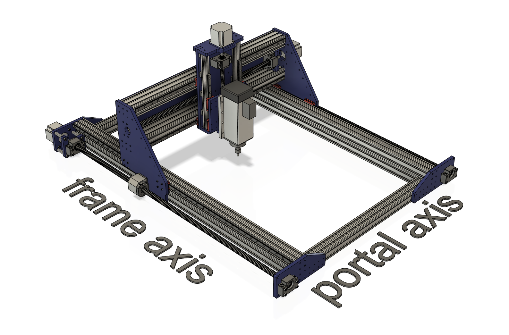 -->

- Slide the nut holders off the nuts, turn them upwards (screw holes of the nut holders look up), put the side plate spacers on the nut holders, screw the side plates to the nut holders with 4x M5x25 (_tight_) screws (**ISO7380 pan head!**). Turn the side plates back by 90°, slide them onto the nuts. Screw the side plates to the rails with 8x M3x14 (_tight_). 

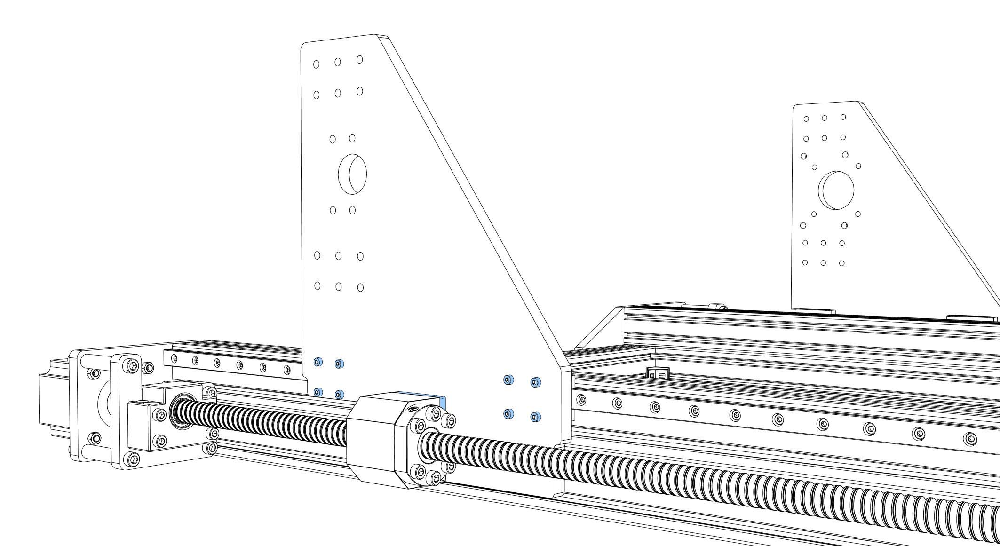
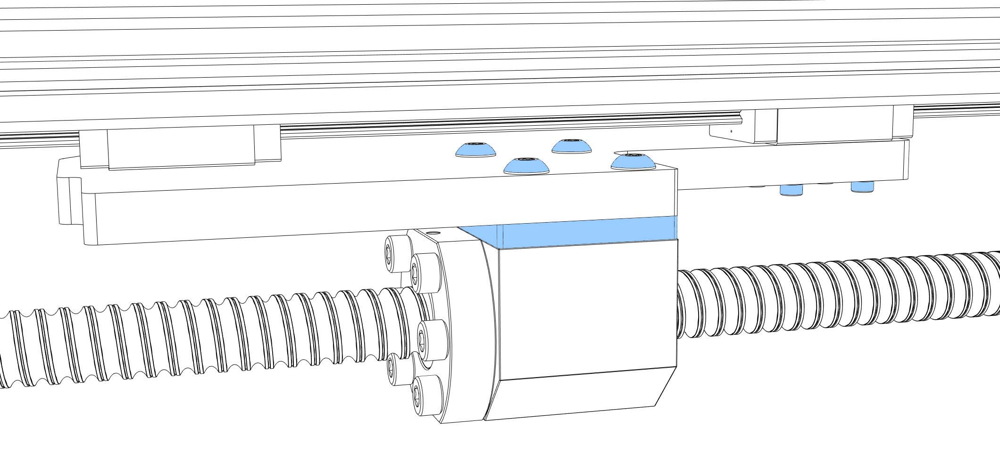

---
**Aligning the frame rails:** 

- Before you start aligning the rails you should consider to attach the frame to the ground plate. In this order you don't destroy your alignment by deforming the frame when screwing it to the plate. The ground plate should be as flat as possible. I used a 20 mm sealed plywood plate with 10 cm extra space in all directions. 
- Prepare yourself a block of plywood with 64 mm height. This block should exactly fit between your frame rails and your ground plate. Loosen all M3x14 screws, start at one end, press the rail onto the block and tighten the corresponding screw (5 Nm max). Move the block one screw and repeat. 
This method will give you only a very rough alignment. I recommend using a [dial indicator](https://s.click.aliexpress.com/e/_9QXALi){:target="_blank"} to align the rail to a deviation of about 2/100 mm.
Use the 3D printed part to connect it to a rail block and check the height to the upper surface of your frame (you are searching for a deviation in Z direction between frame and rail).

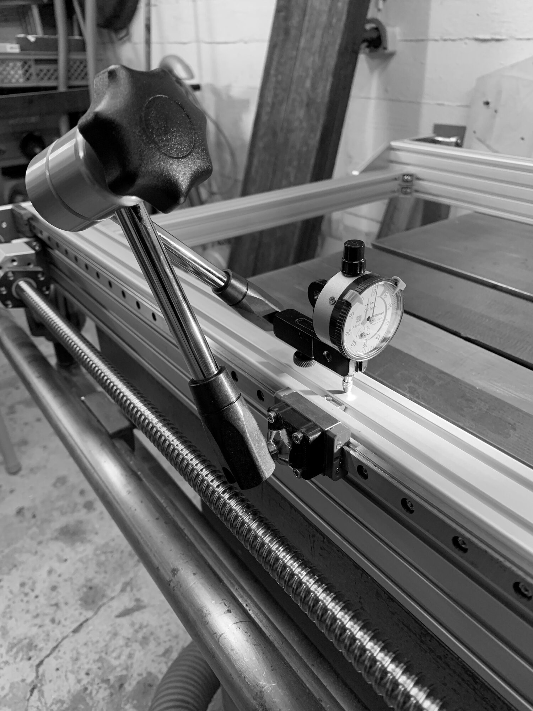

---

 

- Move the side plates backwards until they touch your frame plates. They should now be aligned to one another as good as your frame is rectangular. 

- Tighten the screws between nuts and nut holders (6x M5x20).

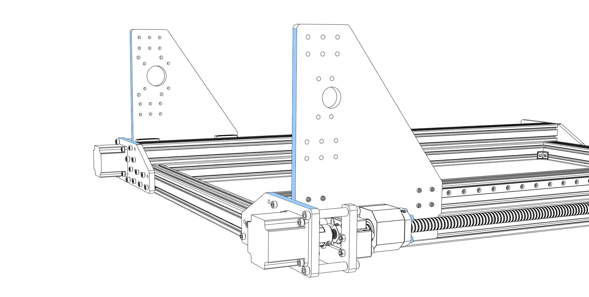

- Move the side plates forward to the BF12 ends. Tighten the screws between BF12 and front frame plates.

- Cut M5 threads into the ends of your 40x60 profiles (approx. 15 mm depth). Prepare the MGN12 rails (degrease and lubricate), put M3x8 screws and nuts in every hole of the rails, slide the rails onto the profiles (_loose_). Each rail has to have two rail blocks (MGN12H). Be careful when sliding the blocks onto the rails (don't loose balls).
Put enough nuts for the backplate into the slots at the back of the profiles (5x M5 nut per slot, 20 in total). If you need attachments on the profiles (limit switches, light, cable chain,..) now is the moment to pre-install nuts into the slots (I have a few extra in each slot).

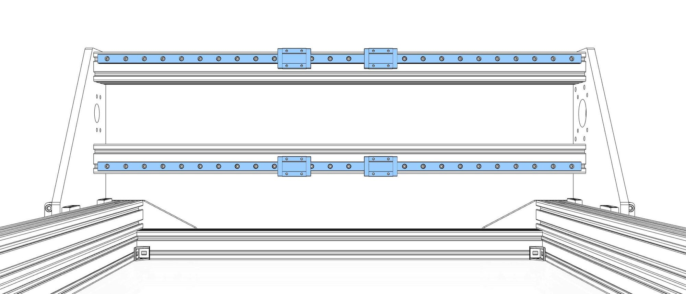

- Screw the profiles to the side plates using 12x M5x20 per side plate (_loose_).

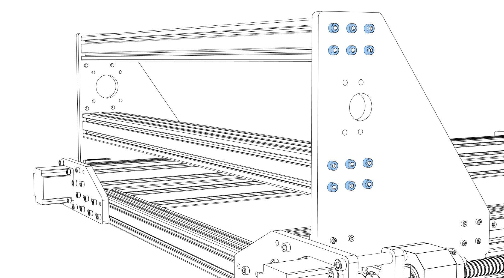

- To help you aligning the portal profiles you can temporarily install the back plate (20x M5x10). Additionally, you can use the portal block plate (symmetrical U shape) as a spacer between the profiles (85 mm distance between profiles). Tighten screws between side plates and profiles (7-8 Nm max). 

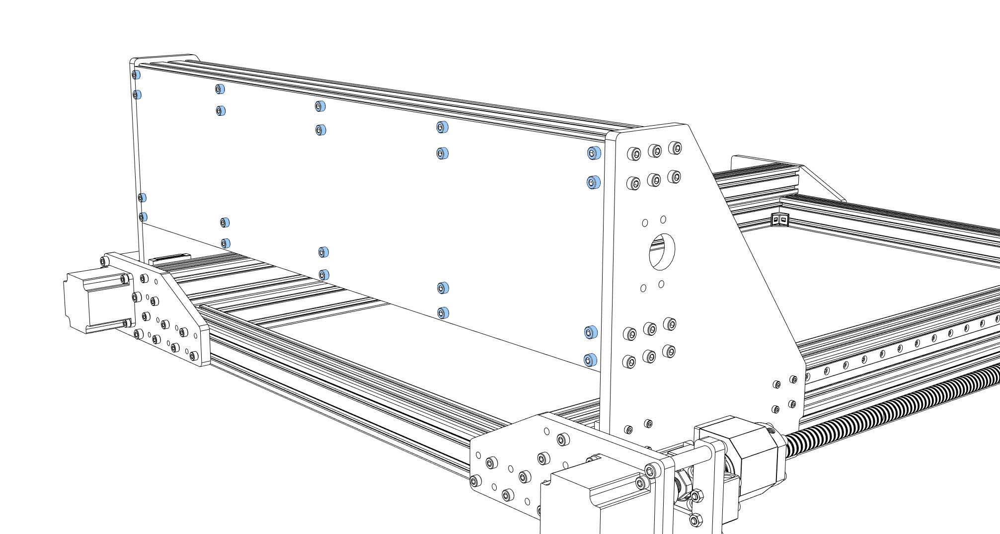

- Take off the back plate.

- Attach the portal block plate to the side plate with 4x 30 mm steel sockets and 8x M6x20 (_tight_).

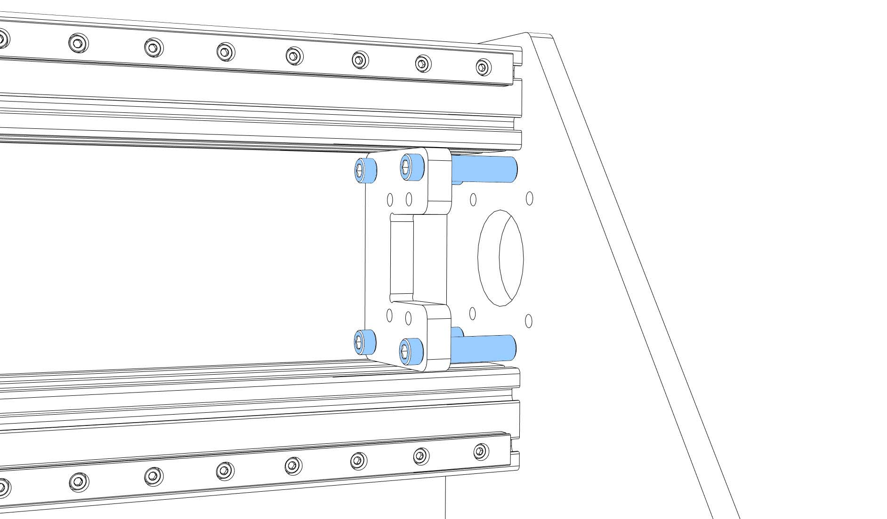

- Prepare the ball screw (SFU1605) (degrease and lubricate). Check if the ball nut is aligned the right way (the end for the screws looks away from the block plate). If they are misaligned you should print yourself a [removal tool](https://www.thingiverse.com/thing:3066990) to turn the nuts without loosing balls. Don't forget the ball nut holder (6x M5x20, _loose_).
- Put the ball screw onto the fixed bearing block (BK12), lock it with the fine nut.
- Put the ball screw onto the BF12 bearing block.
- Slide the ball screw between the profiles, attach the fixed block bearing (BK12) to the portal block plate (symmetrical U shape) with 4x M5x40 + nuts (_tight_). Screw the BF12 bearing block to the side plate (4x M5x35 + nuts, _loose_).

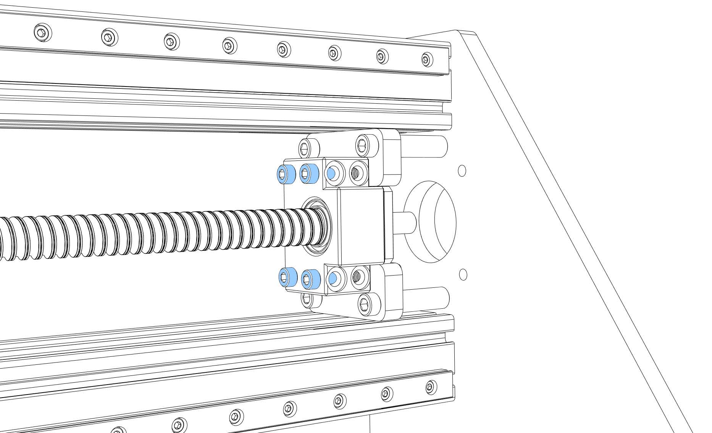
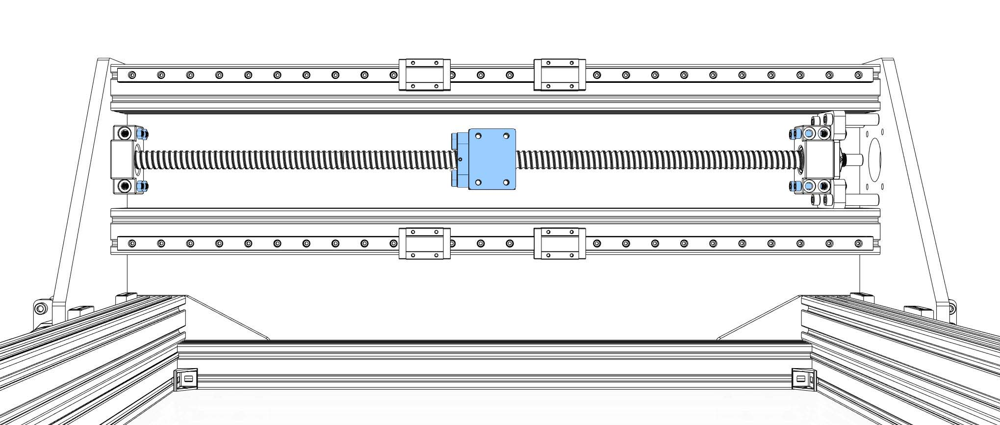

- Screw a coupler onto a NEMA23 motor, tighten the motor shaft side, push the motor through the "portal motor spacer" (10 mm) and the side plate onto the ball screw, tighten the coupler. Screw the motor to the side plate (4x M5x30 + nuts, _tight_).

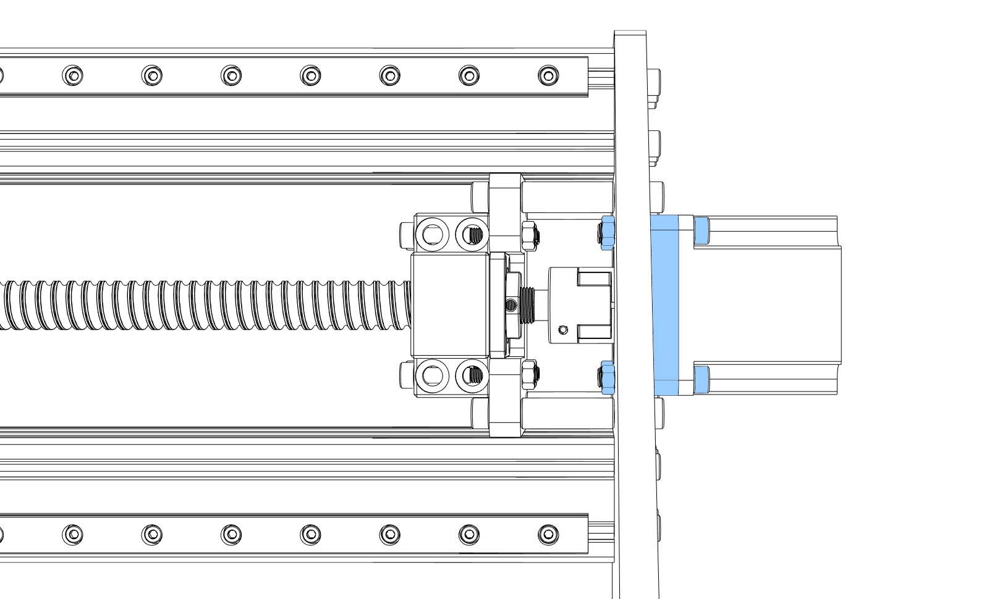

- Install the portal back plate (20x M5x10, _tight_, 5 Nm max)

- The portal is done for now, pause for a moment and enjoy the sight.

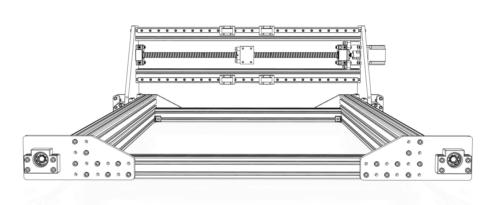

Continue with [Assembly of the Z Axis](/assembly/z_axis_assembly).