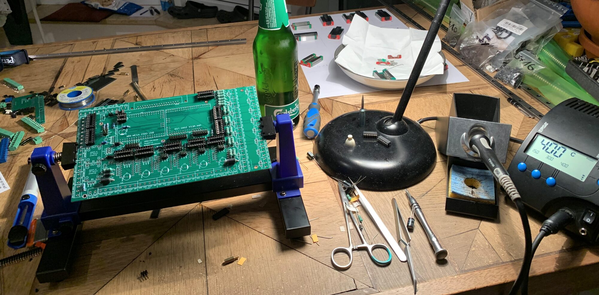
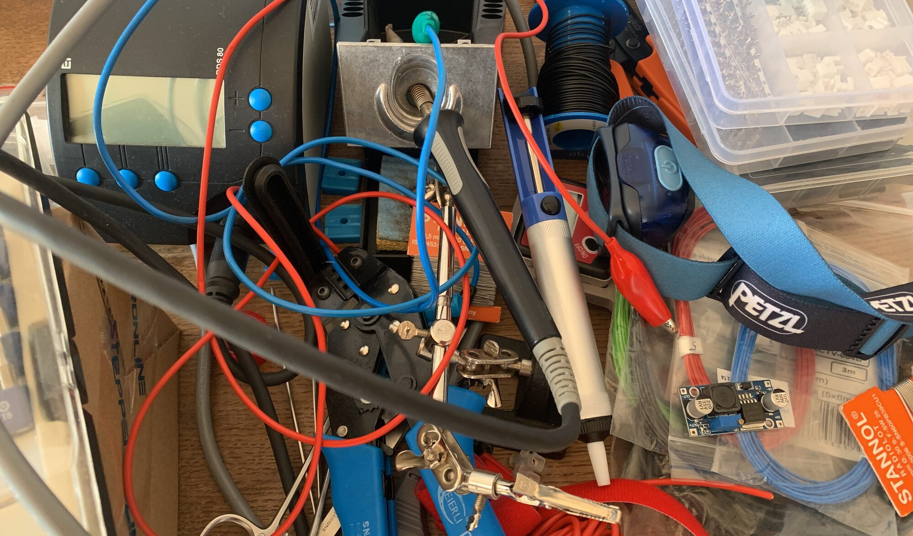

This section covers all electronic parts and tools needed for the build.
I try to link to the cheapest components but prices may vary a lot over time and for different locations so be sure to check all alternatives before placing your order.

## Controller

The controller is the little computer which translates the movement instructions in your G-code (the script which comes out of your CAM program) into voltages with which the motors are driven. 
In the world of hobby machines, this control unit usually consists of an Arduino (a tiny computer) and a shield (a PCB which provides easy access to the ports of the Arduino).
As with PCs, there a numerous operating systems you can run on your CNC machine. 

The CNC Shield V3 is an excellent choice, it's cheap (around 10 €/$), has all the features you need to get started, and is very well documented. You can run the open source software GRBL on it, as well as the proprietary Estlcam. 

| Part Name        | Quantity            | 
| -------------    |:-------------:      | -----:  | -------------: |:-------------:     | -----:      |
| Arduino nano Uno & CNC Shield V3 (GRBL)  |  1 |  [Amazon](https://amzn.to/3dE5sW5){:target="_blank"} | [ebay](https://ebay.us/MZZxGs){:target="_blank"} | [Aliexpress](https://s.click.aliexpress.com/e/_AE4Mps){:target="_blank"}     | 

<!-- [Banggood](https://www.banggood.com/Geekcreit-CNC-Shield-UNO-R3-Board-4xA4988-Driver-Kit-With-Heat-Sink-For-Engraver-3D-Printer-p-1082323.html?cur_warehouse=CN&rmmds=search&p=3R272054556110202106&custlinkid=1674460){:target="_blank"}       -->

I switched to a higher quality shield in combination with Estlcam: 
The [Open CNC shield](https://blog.altholtmann.com/en/open-cnc-shield-2/){:target="_blank"} is very well made and documented but you have to be prepared to solder for a few hours. Alternatively, you could buy a controller board from Estlcam, which is pre-assembled.
Estlcam is easy to setup, inexpensive (50€ after a long trial phase) and has several nice features. You can even use a [wireless X box controller](https://amzn.to/3hfCZqp){:target="_blank"} to remote control the machine!

| Part Name        | Quantity            | 
| -------------    |:-------------:      | -----:  | -------------: |:-------------:     | -----:      |
| Estlcam Controller (Estlcam)  |        1            |         [ebay](https://ebay.us/pGOJKs){:target="_blank"}            |        
| Open CNC Shield (Estlcam)  |        1           |            [Timo's Blog](https://blog.altholtmann.com/en/open-cnc-shield-2/){:target="_blank"}      |      

If you choose to build the Open CNC Shield, a PCB holder is really helpful. You can [print one](https://www.thingiverse.com/thing:965574){:target="_blank"} yourself, I was impatient and bought one from [Amazon](https://amzn.to/3yi68IA){:target="_blank"}. A [suction pump](https://amzn.to/2Ttho66){:target="_blank"} for de-soldering is also a good idea. And your soldering iron should have a bit more power (>=60W): I already had an [ERSA station](https://amzn.to/3AlwtHt){:target="_blank"} from other projects, but a [cheap variant](https://amzn.to/3hrppAo){:target="_blank"} should also do the job. Don't forget beverages. 

## Motors

The Cindymill uses four NEMA23 open loop stepper motors. Their torque usually ranges from 1-3 Nm. Higher torque is preferred but also more expensive. Choose 4 motors:

| Part Name        | Quantity            | 
| -------------    |:-------------:      | -----:  | -------------: |:-------------:     | -----:      |
| NEMA23 1Nm       |     4               |   [Amazon](https://amzn.to/3qEOCeM){:target="_blank"}     | [ebay](https://ebay.us/HJkB28){:target="_blank"} | [Aliexpress](https://s.click.aliexpress.com/e/_A0WrFj){:target="_blank"} | [Banggood](https://www.banggood.com/HANPOSE-23HS5128-51mm-Nema-23-Stepper-Motor-57-Motor-2_8A-101N_cm-4-lead-CNC-Laser-Grind-Foam-Plasma-Cut-Engraving-Machine-p-1560425.html?cur_warehouse=CN&rmmds=search&p=3R272054556110202106&custlinkid=1674533){:target="_blank"}                |             |
| NEMA23 2Nm       |     4               |   [Amazon](https://amzn.to/3dzeF1I){:target="_blank"}     | [ebay](https://ebay.us/1KkYZ7){:target="_blank"} | [Aliexpress](https://s.click.aliexpress.com/e/_A0WrFj){:target="_blank"} | [Banggood](https://www.banggood.com/TWO-TREES-23HS7628-Nema-23-CNC-Stepper-Motor-Driver-Shaft-Diameter-6_35mm-CNC-Stepping-Motor-4-lead-Cable-For-DIY-CNC-Mill-Laser-Grind-Foam-Plasma-Cut-p-1897808.html?cur_warehouse=CN&rmmds=search&p=3R272054556110202106&custlinkid=1674536){:target="_blank"}                |             |
| NEMA23 3Nm       |     4               |   [Amazon](https://amzn.to/3jvU5mO){:target="_blank"}     | [ebay](https://ebay.us/XcyaqR){:target="_blank"}  | [Aliexpress](https://s.click.aliexpress.com/e/_A0WrFj){:target="_blank"} | [Banggood](https://www.banggood.com/HANPOSE-23HS7628-76mm-Nema-23-Stepper-Motor-57-Motor-2_8A-189N_cm-4-lead-CNC-Laser-Grind-Foam-Plasma-Cut-Engraving-Machine-p-1416710.html?cur_warehouse=CN&ID=565876&rmmds=search&p=3R272054556110202106&custlinkid=1674534){:target="_blank"}                |             |

## Drivers

You will need four drivers to control the motors. TB6600 are the cheapest models, but they are loud and slow. I would recommend to take clones of the Leadshine DM series. These are much quieter and you can travel way faster. Note that drivers have to support the current your motors need (all motors mentioned above work with all drivers below).
The main difference between DM542 and DM556 drivers is the maximum supported current. Even for the 3kN motors you can take the DM542, so DM556 drivers are not needed now and would only be justified as an investment into a possibly bigger build in the future. Choose 4 drivers:

| Part Name        | Quantity            | 
| -------------    |:-------------:      | -----:  | -------------: |:-------------:     | -----:      |
| TB6600       |     4               |   [Amazon](https://amzn.to/30buSq0){:target="_blank"}     |  [ebay](https://ebay.us/GRd2mC){:target="_blank"} | [Aliexpress](https://s.click.aliexpress.com/e/_AnJmXf){:target="_blank"} |  [Banggood](https://www.banggood.com/TB6600-Upgraded-Stepper-Motor-Driver-Controller-for-4A-9~40V-TTL-32-Micro-Step-2-or-4-Phase-of-42-or-57-Stepper-Motor-3D-Printer-CNC-Part-p-1453122.html?akmClientCountry=DE&cur_warehouse=CN&rmmds=search&p=3R272054556110202106&custlinkid=1674545){:target="_blank"}
| Leadshine DM542       |     4               |   [Amazon](https://amzn.to/3wh3lxD){:target="_blank"} | [ebay](https://ebay.us/6ZGjKr){:target="_blank"} | [Aliexpress](https://de.aliexpress.com/item/1005001905873184.html?spm=a2g0o.productlist.0.0.30c11418UFSSAv&aem_p4p_detail=20210709045755662646301657550006090667){:target="_blank"} |  [Banggood](https://www.banggood.com/DM542-Stepper-Motor-Controller-2-phase-Digital-Stepper-Motor-Driver-18-48-VDC-Max_-4_2A-for-42-or-57-or-86-Series-Motor-p-1838967.html?cur_warehouse=CN&rmmds=search&p=3R272054556110202106&custlinkid=1674547){:target="_blank"}
| Leadshine DM556       |     4               |   [Amazon](https://amzn.to/3jxs7qR){:target="_blank"} | [ebay](https://ebay.us/neditB){:target="_blank"} | [Aliexpress](https://s.click.aliexpress.com/e/_AZZAbe){:target="_blank"} |   [Banggood](https://www.banggood.com/5_6A-DC-24-50V-57-or-86-2-Phase-Stepping-Driver-DM556-Stepper-Motor-Driver-Board-p-1374317.html?cur_warehouse=CN&rmmds=search&p=3R272054556110202106&custlinkid=1674548){:target="_blank"}

## Power Supply

The first important question when choosing a power supply unit (PSU) is with which voltage you want to work. All mentioned drivers theoretically support 48V, but I wouldn't recommend it for the TB6600. However, more voltage means more fun because the motors will maintain stronger in higher velocities. This means that you can go faster with more voltage.
You can start with 12V but I would highly recommend to directly take 36V or 48V.

The second important question is that it has to have enough power to drive the 4 motors. As a rule of thumb you can add up the current of all motors (e.g. 4x 2.8A = 11.2A), the PSU should roughly be able to deliver this current (they won't all pull max current at the same time so you can stay a bit below this value if needed). Plus you will need some current to drive the controller and maybe some LEDs. For the 1Nm motors with 2.8A max, a 12-16A PSU would be ok. If you go with 3Nm motors with 4.2A and have lots of periphery, maybe a 20A PSU is a better choice.

Depending on the combination of PSU and controller you choose you will need a source of 12V or 24V to power the controller. If you use a step down converter you don't need another PSU just for the periphery.

| Part Name        | Quantity            |
| -------------    |:-------------:      | -----:  | -------------: |:-------------:     | -----:      |
| Power Supply 12V     |     1              |   [Amazon](https://amzn.to/2UhTWcb){:target="_blank"}     |  [ebay](https://ebay.us/Q41TGf){:target="_blank"}     | [Aliexpress](https://s.click.aliexpress.com/e/_AOVr6C){:target="_blank"}         
| Power Supply 24V     |     1              |   [Amazon](https://amzn.to/3hhzWQ1){:target="_blank"}     |  [ebay](https://ebay.us/AxsAuC){:target="_blank"}     | [Aliexpress](https://s.click.aliexpress.com/e/_9GF1iY){:target="_blank"}         
| Power Supply 36V     |     1              |   [Amazon](https://amzn.to/3hssq3r){:target="_blank"}                         | [Aliexpress](https://s.click.aliexpress.com/e/_AMObBK){:target="_blank"}                                       |             |
| Power Supply 48V   |     1              |   [Amazon](https://amzn.to/3qFsVvj){:target="_blank"}     |    [ebay]( https://ebay.us/O0Mxwn){:target="_blank"}   | [Aliexpress](https://s.click.aliexpress.com/e/_AWyqjQ){:target="_blank"} |                                      |             |
| Step down converter       |     1              |   [Amazon](https://amzn.to/368oYps){:target="_blank"}     | [ebay](https://ebay.us/mWDNKW){:target="_blank"}      | [Aliexpress](https://s.click.aliexpress.com/e/_9IFgzK){:target="_blank"}         |             |

## Spindle

You could start with a 500W spindle:

| Part Name        | Quantity            | 
| -------------    |:-------------:      | -----:  | -------------: |:-------------:     | -----:      |
| 500W Spindle Motor |     1             |  [Amazon](https://amzn.to/2Sz1dDM){:target="_blank"}     | [Aliexpress](https://s.click.aliexpress.com/e/_9QMwic){:target="_blank"}  |   |             |

I would recommend a 1.5kW HF spindle, mine is air cooled but water cooled would be in the same price range and it's quieter. You need 1 spindle and 1 frequency converter:

| Part Name        | Quantity            | 
| -------------    |:-------------:      | -----:  | -------------: |:-------------:     | -----:      |
| 1.5kW Spindle + Frequency Converter Air cooled |     1                |  [Amazon](https://amzn.to/2UVZ45Q){:target="_blank"}      |      [eBay](https://ebay.us/H6Srn0){:target="_blank"}           |  [Aliexpress](https://s.click.aliexpress.com/e/_Aq6vnS){:target="_blank"}      |      |
| 1.5kW Spindle + Frequency Converter Water cooled |     1                |  [Amazon](https://amzn.to/3n59cnk){:target="_blank"}      |      [eBay](https://ebay.us/vB7qLV){:target="_blank"}           |   [Aliexpress](https://s.click.aliexpress.com/e/_AcqZhW){:target="_blank"}    

All mentioned spindles use so-called ER11 collets (the connector between spindle and your bit), which implicates that the maximum diameter usable is 7 mm (however, there are "out of norm" [ER11-8mm collets](https://amzn.to/2TnLjg5){:target="_blank"}). If your spindle does not come with a set of collets for different bit diameters you will need to order one extra: 

| Part Name        | Quantity            | 
| -------------    |:-------------:      | -----:  | -------------: |:-------------:     | -----:      |
| ER11 Collet Set |     1                | [Amazon](https://amzn.to/3x7zNEf){:target="_blank"}  |   [Aliexpress](https://s.click.aliexpress.com/e/_AkCjC8){:target="_blank"} |  

### Milling Cutters

- I would recommend to start only with 1- or 2-flute cutters (flute = cutting edge). I write about why [in a separate post](/start/2021/08/01/SpeedsAndFeeds) since this goes right into the rabbit hole of milling theory and takes a bit more space.
- Another important rule of thumb is that your cutters should be as short and thick as possible to maximize stiffness.
- A high quality cutter can cost up to hundreds of €/$. Since destroying cutting bits is an obligatory side effect of learning how it's done, I would highly recommend to start with cheap ones from China where you can get a bit for roughly 2€/$. It won't stay sharp for long but you will ruin it anyway :)

These are cutters I use for **clearing pockets and contours** in wood, acrylic and aluminum:

| Part Name        | 
| 1/8" 1-flute (Aluminum) |     [Amazon](https://amzn.to/3qzSjmb){:target="_blank"}   |    [Aliexpress](https://s.click.aliexpress.com/e/_99oJUG){:target="_blank"}            |       |             |
| 1/8" 2-flute (Wood, Plastic) |      [Amazon](https://amzn.to/3Ae1KMi){:target="_blank"}        |                |       |             |
| 1/8" 1-flute (Wood, Plastic) |      [Aliexpress](https://s.click.aliexpress.com/e/_Akhe1K){:target="_blank"}       |     |             |
| 6mm 2-flute (Wood) |             [Amazon](https://amzn.to/3h8IIQe){:target="_blank"}         |  [Aliexpress](https://s.click.aliexpress.com/e/_AWTAa8){:target="_blank"}    |             |

**Cutters for engraving**, I used them for plywood and acrylic so far:

| Part Name        | 
| Engraving bit |      [Amazon](https://amzn.to/3xaB8Kh){:target="_blank"}   |   [Aliexpress](https://s.click.aliexpress.com/e/_A1k2o0){:target="_blank"}      

**Chamfer bits** are good for finishing edges after cutting. I have several with 3-6 mm diameter and use them for all materials:

| Part Name        |
| Chamfer bit |      [Amazon](https://amzn.to/2TpJbnM){:target="_blank"}    |   [Aliexpress](https://s.click.aliexpress.com/e/_ALjXuG){:target="_blank"}    |  

## Tools and Cables

You will need a digital multimeter, a soldering station, cable cutter, crimp tool, crimps, ...

Cables coming soon.

<!--  -->

[Back to Parts](/parts)

---
This page contains affiliate links. If you use these links to buy something I may earn a commission at no additional cost to you, which helps me to maintain this website. Thanks.