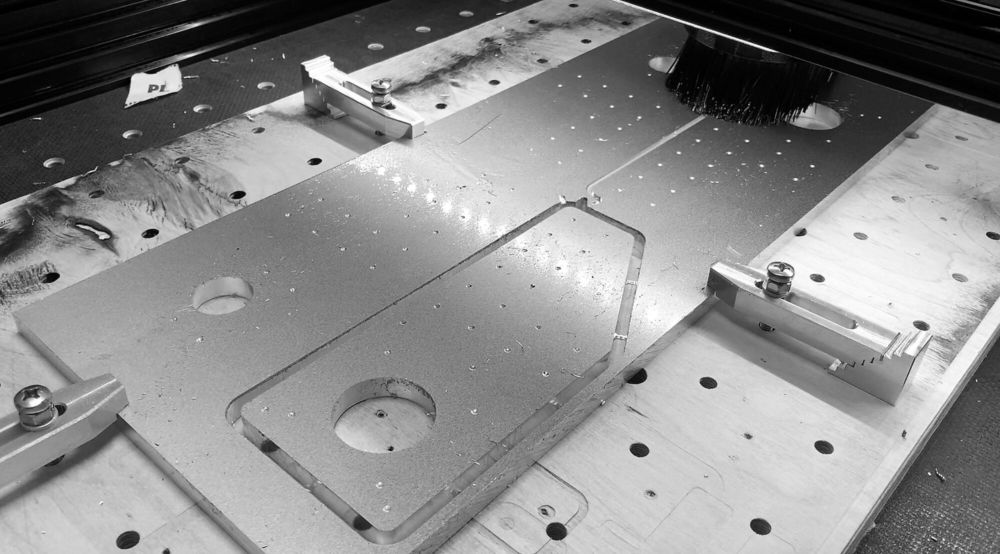
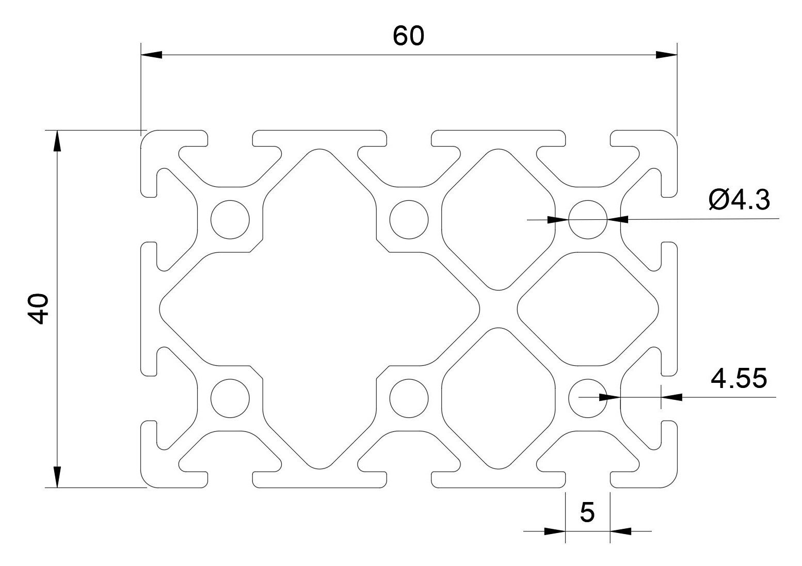
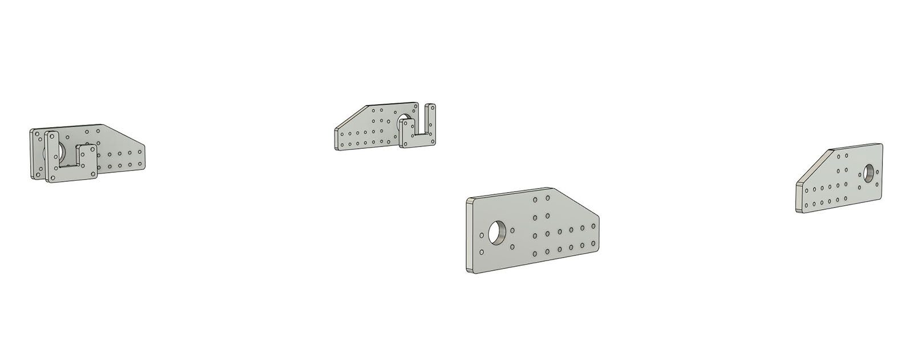
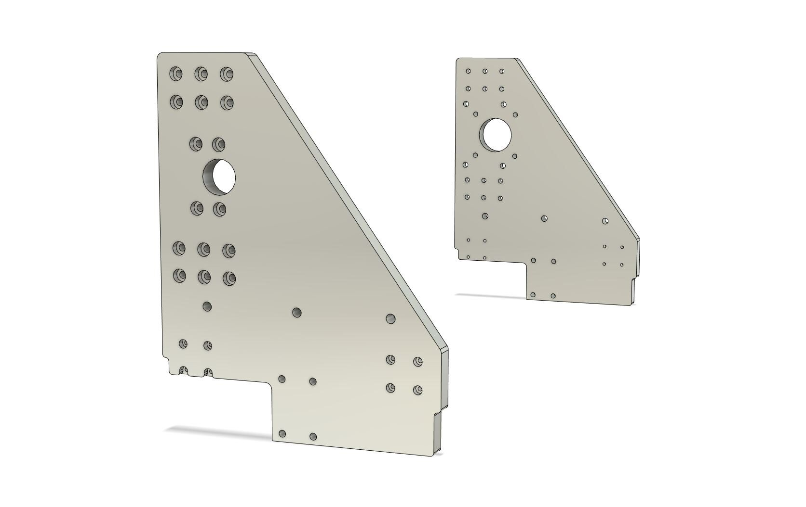
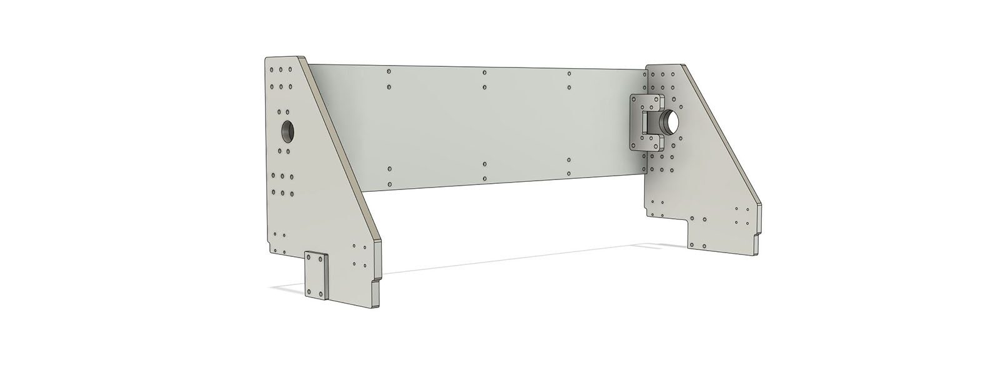
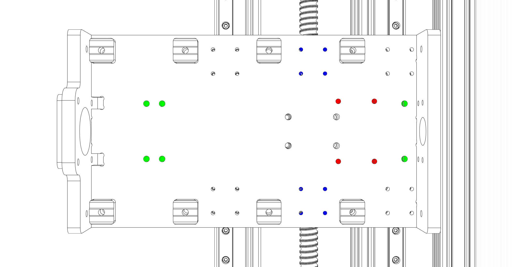
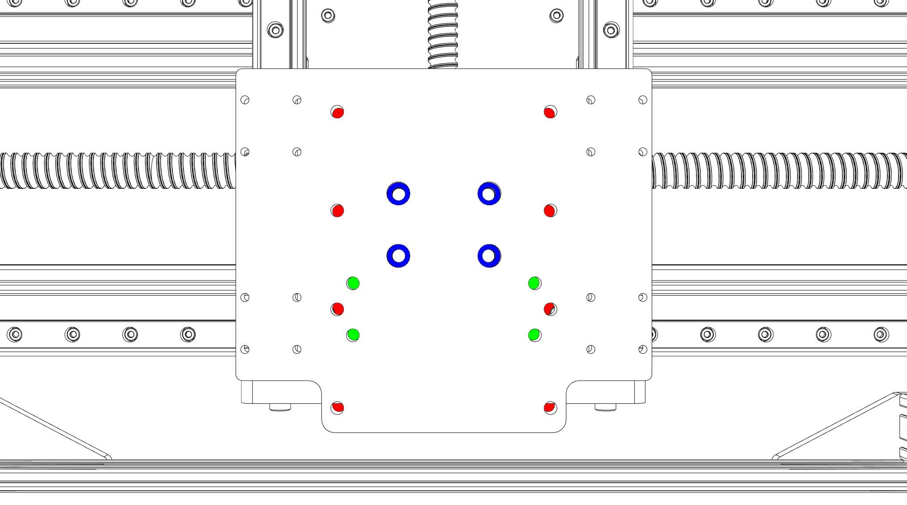
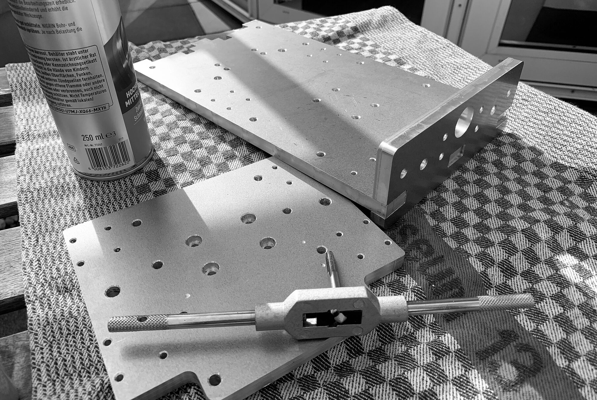
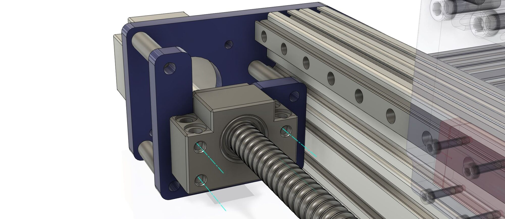

This section describes the parts you need to upgrade an Indymill. Just follow the according [sections](/assembly/) for the assembly.

If you have an Indymill it is easy to upgrade to a more reliable machine without spending too much money.
Some of the upgrades listed below are independent of each other. To "stay in proportion" it is recommended to make all changes but you can make them one after another in a way: 
- You could upgrade to real block bearings without changing the profiles, the plates would also work with the old profiles,
- You could switch the Z axis to ball screw without changing anything else.

## Which aluminum should you buy?

Do yourself a favor and avoid aluminum sheets from the hardware store. These alloys are usually much too soft and therefore very difficult to mill (often impossible without active cooling). 
Brittle alloys with higher tensile strength are way easier to machine. The following alloys are considered to be very easy to mill:

| EN        | old Norm      | | |
| :-------------    |:-------------      | :-------------      | :-------------      |
| EN AW-2007   |  AlCuMgPb                 |   [ebay](https://ebay.us/AqbHIX){:target="_blank"}  |
| EN AW-2011  |    AlCuBiPb               |   
| EN AW-2017   |  AlCuMg1                 |  
| EN AW-5083  |    AlMg4,5Mn               |   [ebay](https://ebay.us/wQt1kT){:target="_blank"} |  [Amazon](https://amzn.to/3ibNiNU){:target="_blank"}

I have successfully milled both AW-2007 and AW-5083 without active cooling. I still have a stock of AW-2007 sheets but since my milling parameters ("feeds and speeds") are dialed in for AW-5083 now, I actually only machine AW-5083 at the moment.
          

 

## Extruded Profiles 

All used T-slot profiles are "I-Type slot 5" based, which means that a cross-section with one T-slot on each side has the dimensions 20 mm x 20 mm and the slot has 5 mm width.
As far as I learned, there are two types of extrusions in Europe, I-type (by the company Item) and B-type (by the company Bosch). The profiles I initially ordered from Banggood for the Indymill were neither one nor the other. Accordingly, the nuts you order fit sometimes better and sometimes worse. This makes the precise alignment of the rails on the profiles unnecessarily difficult. So for the Cindymill I ordered everything I-type based from Europe and it fits way better. The nuts even have small bars which help to center them in the slot (that's also the reason why I switched from hammer nuts to those which you have to slide into the slot before closing it).
So compare the prices from banggood vs. quality profiles from Europe/US, for me it was even cheaper to order them locally.

Another important point: The "I-Type slot 5" profiles have tapholes for M5 threads (diameter 4.3 mm). All plates which are screwed to profile ends are prepared for M5. If you buy another system check for the taphole diameter. If needed I can export a set of plate files which are prepared for M6, just send me a message. 

The given lengths are for my machine, if you have other dimensions just change the last values of frame and gantry profiles:

| Part Name        | Quantity       | Dimensions       |
| -------------    |:-------------: | :-----           | -------------: |:-------------:     | -----:           |
| Frame Profiles    |  2            | 40 x 80 x 1000   |                                                        | [ebay](https://ebay.us/sN9eL3){:target="_blank"} | [Motedis](https://www.motedis.com/shop/Aluprofile/Aluprofil-40x80-I-Typ-Nut-5::3799.html){:target="_blank"}                  |             |
|                   |  2            | 40 x 40 x 560    | [Amazon](https://amzn.to/3jEKvht){:target="_blank"}    | [ebay](https://ebay.us/j6LjRD){:target="_blank"} | [Motedis](https://www.motedis.com/shop/Aluprofile/Aluprofil-40x40-I-Typ-Nut-5::686.html){:target="_blank"}                |             |
|  Gantry Profiles  |   2           | 40 x 60 x 666    | [Amazon](https://amzn.to/3heS3WB){:target="_blank"}    | [ebay](https://ebay.us/Wt5Shb){:target="_blank"} | [Motedis](https://www.motedis.com/shop/Aluprofile/Aluprofil-60x40-I-Typ-Nut-5::737.html){:target="_blank"}                   |             |
|  Z Axis Profiles  |   2           |  20 x 20 x 270   | [Amazon](https://amzn.to/366R8kK){:target="_blank"}    | [ebay](https://ebay.us/PpNqCB){:target="_blank"} | [Motedis](https://www.motedis.com/shop/Aluprofile/Aluprofil-20x20-I-Typ-Nut-5::1076.html){:target="_blank"}                   | 
|  T-nut with bar I-Typ Nut 5 [M3]  |   150           |     | [Amazon](https://amzn.to/3AnZrXg){:target="_blank"}    | [ebay](https://ebay.us/Ysmv9w){:target="_blank"} | [Motedis](https://www.motedis.com/shop/Nutprofil-Zubehoer/In-der-Nut/Nutenstein-mit-Steg-I-Typ-Nut-5-M3::4224.html){:target="_blank"}                          |
|  T-nut with bar I-Typ Nut 5 [M5]  |   50          |     | [Amazon](https://amzn.to/3wdl4WT){:target="_blank"}    | [ebay](https://ebay.us/lpHojt){:target="_blank"} | [Motedis](https://www.motedis.com/shop/Nutprofil-Zubehoer/In-der-Nut/Nutenstein-mit-Steg-I-Typ-Nut-5-M5::4226.html){:target="_blank"}                           |
|  Brackets I-Typ Nut 5  |   5-10          |     | [Amazon](https://amzn.to/3AmN7X7){:target="_blank"}    | [ebay](https://ebay.us/Z5UlBC){:target="_blank"} | [Motedis](https://www.motedis.com/shop/Nutprofil-Zubehoer/Winkel-fuer-Aluprofil/Winkel-20-I-Typ-Nut-5::732.html){:target="_blank"}                   |             |

The number of M3 T-nuts takes into account that you use every borehole in the rails - which I highly recommend for the greatest possible rigidity. 

For the connections between fixed block bearings and the frame you need threaded steel sockets (inner thread diameter M6, outer diameter 10 mm, length 30 and 40 mm). If the links don't work for you, search for the following keywords: "Threaded sockets", "long nuts", "round long nuts", "connecting nuts", "threaded sleeves".

| Part Name        | Quantity            |
| -------------    |:-------------:      | -----:  | -------------: |:-------------:     | -----:      |
| Portal Axis: Threaded sockets M6 x 10 x 30  |      4               |  [ebay](https://ebay.us/vBWF3L){:target="_blank"}       |  [Amazon](https://amzn.to/3hz61RV){:target="_blank"}{:target="_blank"}               |     [Aliexpress](https://s.click.aliexpress.com/e/_A11cnq){:target="_blank"}{:target="_blank"}               |             |
| Frame Axis: Threaded sockets M6 x 10 x 40  |    8                 | [ebay](https://ebay.us/vBWF3L){:target="_blank"}        |   [Amazon](https://amzn.to/3AtfEuq){:target="_blank"}{:target="_blank"}              |                    |             |

I ordered more than enough, if you can't find them send me a message in our facebook group!

You will need to cut M5 threads into the ends of the profiles (and M6 threads into one of the milled plates), I have bought this [set of thread cutters](https://amzn.to/3dXKEc2){:target="_blank"} for the job.

 

## Milled Plates

If you feel comfortable milling aluminum you can produce all plates on your Indymill. If not, you could start by making them from plywood, assemble, and mill them again from aluminum. If you don't have a functional milling machine at hand you will have to find somebody who produces the plates for you. Easiest way would be to ask in our facebook group if somebody can produce them for you.
<!-- I am planning to produce a few sets from 10 mm aluminum, so if you need one you can send me a message. But since I don't have them laying around it will take a bit.   -->

### Frame
For the frame six parts have to be produced, all have 10 mm thickness:

- *1x_Cindymill_Frame_Block_Plate_L_10mm.dxf*
- *1x_Cindymill_Frame_Block_Plate_R_10mm.dxf*
- *1x_Cindymill_Frame_Plate_L_B_10mm.dxf*
- *1x_Cindymill_Frame_Plate_L_F_10mm.dxf*
- *1x_Cindymill_Frame_Plate_R_B_10mm.dxf*
- *1x_Cindymill_Frame_Plate_R_F_10mm.dxf*

L and R are left and right, F and B are front back. The frame is symmetric, so you can also make the L parts twice.

### Portal

For the portal eight parts have to be produced, some have to be 10 mm, for others you can vary the thickness:

The **sideplates** are made with 10 mm thickness but you can increase strength up to 15 mm if you want. 
- *1x_Cindymill_Portal_Sideplate_L_10-15mm.dxf*
- *1x_Cindymill_Portal_Sideplate_R_10-15mm.dxf*

The only thing that has to be adjusted is the **spacer** strength at the side plates, in total you have to have 15 mm strength (if you take 15 mm side plates you don't need spacers).
- *2x_Cindymill_Portal_Sideplate_Spacer_5-0mm.dxf*

I added a stp file for the side plates with 15 mm thickness if you want to go big. They have countersinks, so that you can use all the screws from the list as if it was the normal 10 mm version. You will find it under: */Milled_Parts/Cindymill_15mm_Sideplates.step*

The **backplate** on the portal is usually underestimated - it's is essentially important for the stiffness of the portal ([see this post](/start/2021/07/24/Rigidity){:target="_blank"})! If you don't want / can produce such a big part from aluminum just make it from plywood to begin with. I made it from 6 mm aluminum. 
- *1x_Cindymill_Portal_Backplate_5-10mm.dxf*

**More plates** in 10 mm:
- *1x_Cindymill_Portal_Block_Plate_10mm.dxf*
- *1x_Cindymill_Portal_Motor_Spacer_10mm.dxf*
- *1x_Cindymill_Portal_Nut_Spacer_10mm.dxf*

If not possible otherwise, you could also print the two ".._Spacer_.." parts. If so, print them heavy (4 perimeters, 75% infill).

### Z Axis

For the Z axis six parts have to be produced:

The main plates all have 10 mm thickness:
- *1x_Cindymill_Z_Axis_Backplate_10mm.dxf*
- *1x_Cindymill_Z_Axis_Bottomplate_10mm.dxf*
- *1x_Cindymill_Z_Axis_Topplate_10mm.dxf*
- *1x_Cindymill_Z_Axis_Spindle_Plate_10mm.dxf*

Two spacers have to be made (with 3 mm and 5 mm thickness), you can print them (heavy):
- *1x_Cindymill_Z_Axis_Spindle_Plate_Spacer_3mm.dxf*
- *1x_Cindymill_Z_Axis_Motor_Spacer_5mm.dxf*

Depending on your combination of components you will have to **thread a few holes**:

---

__Backplate color codes:__ 
- __red:__ only needed if you use the new Z axis with the indymill portal. If so, need to be threaded with M5,
- __green:__ for bearing blocks, need to be threaded with M6,
- __blue:__ only needed if you use the new Z axis with the indymill portal.

---

__Spindleplate color codes:__ 
- __red:__ only needed if you use the 1.5kW spindle. If so, need to be threaded with M6,
- __green:__ only needed if you use the 500W spindle. If so, need to be threaded with M6,
- __blue:__ Countersinks needed for M6 screw heads (diameter 9 mm, depth 5 mm).

The spindle plate is the only part with countersinks so even if you plan to laser cut or water cut the plates, this plate has to be treated afterwards.

 

## Ball Screws, Z Axis

The Cindymill uses ball screws on all axes. To upgrade your Z axis you will need a SFU1204 ball screw, block bearings, and a coupler:

| Part Name        | Quantity            | Length
| -------------    |:-------------:      | -----:  | -------------: |:-------------:     | -----:      |
| Z Axis Ball Screw SFU1204 |  1 | 250 | [Amazon](https://amzn.to/3hqGwDS){:target="_blank"}  | [ebay](https://ebay.us/1Zq9bS){:target="_blank"}  | [Aliexpress](https://s.click.aliexpress.com/e/_AatEmy){:target="_blank"}    | 

You need two bearing blocks per ball screw: BK12 and BF12 for SFU1605, BK10 and BF10 for SFU1204. If they are not part of a ball screw set, you will need to order them separately. 
To be able to attach them to the frame the blocks have to have holes in axial direction. Be sure that the blocks you order have these holes (see image below). 

| Part Name        | Quantity            
| -------------    |:-------------   | -----:  | -------------: |:-------------:     | -----:      |
| BK12 + BF12 |  3 (2x frame + 1x portal) |   [Amazon](https://amzn.to/3AJaSZU){:target="_blank"}  | [ebay](https://ebay.us/zruIib){:target="_blank"}  | [Aliexpress](https://s.click.aliexpress.com/e/_A4ONTS){:target="_blank"}    | 
| BK10 + BF10 |  1 (1x Z axis)            |   [Amazon](https://amzn.to/3yzkHYd){:target="_blank"}  | [ebay](https://ebay.us/zruIib){:target="_blank"}  | [Aliexpress](https://s.click.aliexpress.com/e/_AXdMQ4){:target="_blank"}    |

Future alternative: FF12, FK12..

Check the shafts of your NEMA23 motors. They usually have a diameter of either 6.35 mm or 8 mm. The ends of the ball screw has 8 mm (SFU1204) diameter.

| Part Name        | Quantity            
| -------------    |:-------------   | -----:  | -------------: |:-------------:     | -----:      |
| SFU1204 Coupler 6.35/8 x 8 mm |  1 (1x Z axis)             |   [Amazon](https://amzn.to/3AFeNqA){:target="_blank"}  | [ebay](https://ebay.us/3OATsy){:target="_blank"}  | [Aliexpress](https://s.click.aliexpress.com/e/_A58PZA){:target="_blank"}    |

 

## Printed Upgrades

I published several **3D printed modifications to the original Indymill** on Thingiverse. If you want to start slowly and just stiffen your indymill a bit, feel free to check them out:

- Last state of my [complete Indymill model](https://www.thingiverse.com/thing:4854879){:target="_blank"} (already has a ball screw Z axis) 
- A [ball screw Z axis](https://www.thingiverse.com/thing:4777775){:target="_blank"} (similar to the Cindymill)
- A [spacer plate](https://www.thingiverse.com/thing:4717869){:target="_blank"} to be able to attach a 1.5kW spindle on the Indymill
- A tougher [Z axis nut holder](https://www.thingiverse.com/thing:4693706){:target="_blank"}
- [SFU1204 nut holder](https://www.thingiverse.com/thing:4818615){:target="_blank"} for the portal axis (for the case that you ordered SFU1204)
- A [spacer plate](https://www.thingiverse.com/thing:4764569){:target="_blank"} for NEMA23 motors
- [Limit switches](https://www.thingiverse.com/thing:4762828){:target="_blank"} for all axes
- New [X axis nut holders](https://www.thingiverse.com/thing:4738776){:target="_blank"} 
- A tougher [Y axis nut holder](https://www.thingiverse.com/thing:4738756){:target="_blank"}
- A [thing](https://www.thingiverse.com/thing:4717961){:target="_blank"} to attach a cable chain to extruded 20x20 profile
- Printable [spacers](https://www.thingiverse.com/thing:4717914){:target="_blank"} to help centering the Z-Axis
- A tougher Z axis [bearing holder](https://www.thingiverse.com/thing:4717741){:target="_blank"}
- A [vacuum cleaner holder](https://www.thingiverse.com/thing:4866834){:target="_blank"} for the 1.5 kW spindle

[Back to Parts](/parts)

---

This page contains affiliate links. If you use these links to buy something I may earn a commission at no additional cost to you, which helps me to maintain this website. Thanks.