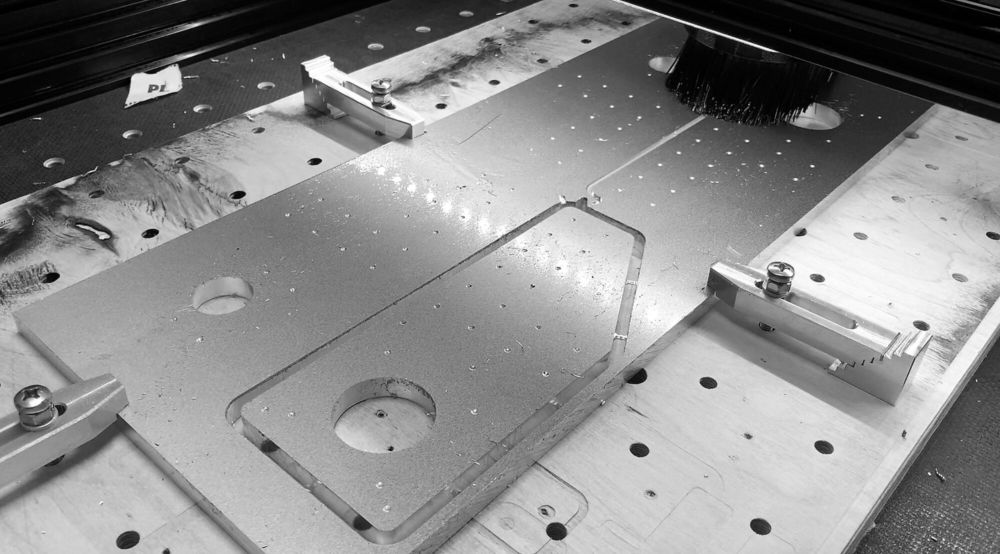
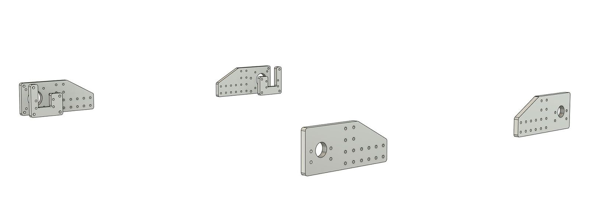
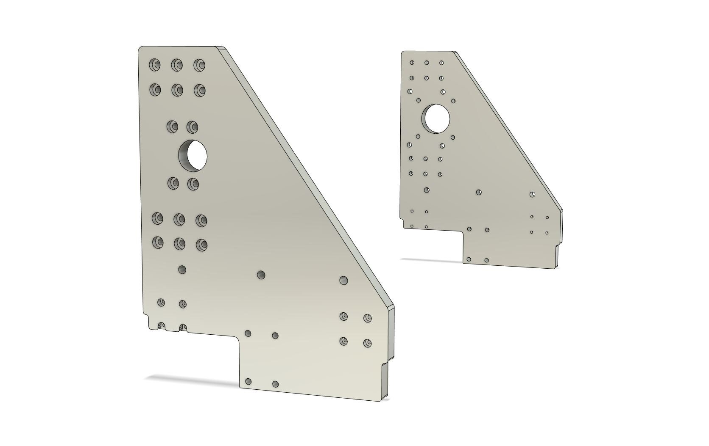
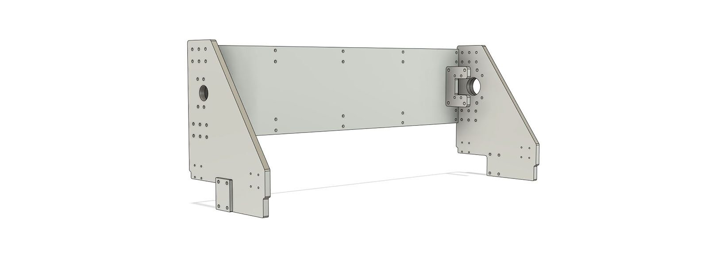
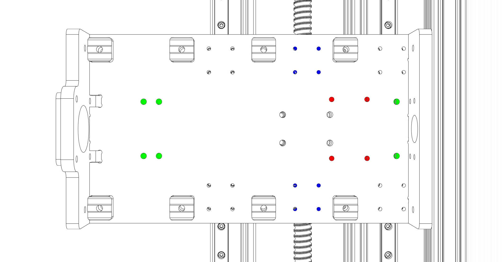
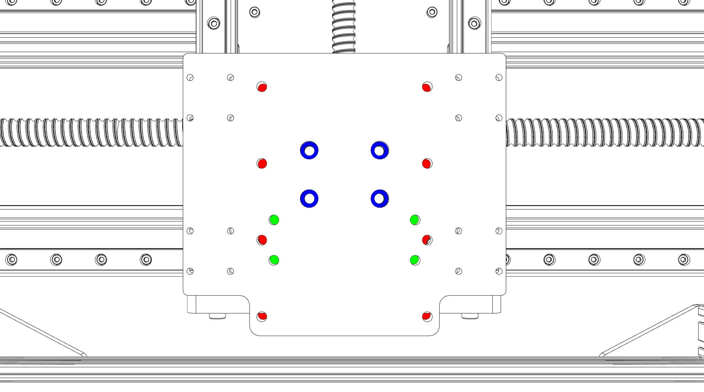
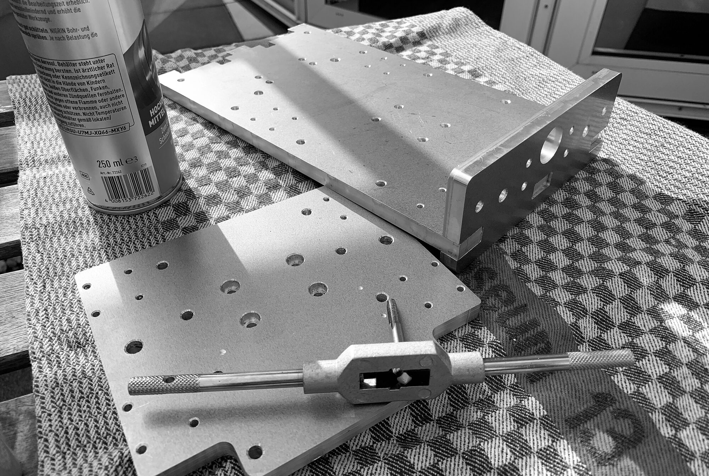

This section covers all parts which have to be milled. 

This should be the most critical part since it is not possible to just order the components from ebay (yet). 
Some short notes:

- All plates are designed to be produced from 10 mm thick sheet material. The thickness of the gantry side plates could be increased to 15 mm. 
- The designs are as simple as possible, except for 4 holes there is no need for countersinks. Therefore, the plates can be produced by milling, laser cutting, or water jet cutting.
- I milled the plates from aluminum but it is also possible to produce them from steel. If you have a milling machine which can only mill wood, a good path could also be to mill the plates provisionally from plywood, assemble the Cindymill, and to mill them again from aluminum. 
- If you plan to have them laser cut from steel: I learned that the minimum bore hole diameter has to be at least the material strength. So, there is no useful way to laser a 5 mm drill hole into a 10 mm steel plate. A workaround can be: let the company cut only the contours, then "center-punch" all the drill holes on a CNC machine (to have precise locations) and drill press them yourself.
I am looking into this at the moment, eventually I will be able to offer a bulk order of cut steel plates with center-punched drill holes where you would only have to drill the holes.

## Which aluminum should you buy?

Do yourself a favor and avoid aluminum sheets from the hardware store. These alloys are usually much too soft and therefore very difficult to mill (often impossible without active cooling). 
Brittle alloys with higher tensile strength are way easier to machine. The following alloys are considered to be very easy to mill:

| EN        | old Norm      | | |
| :-------------    |:-------------      | :-------------      | :-------------      |
| EN AW-2007   |  AlCuMgPb                 |   [ebay](https://ebay.us/AqbHIX){:target="_blank"}  |
| EN AW-2011  |    AlCuBiPb               |   
| EN AW-2017   |  AlCuMg1                 |  
| EN AW-5083  |    AlMg4,5Mn               |   [ebay](https://ebay.us/wQt1kT){:target="_blank"} |  [Amazon](https://amzn.to/3ibNiNU){:target="_blank"}

I have successfully milled both AW-2007 and AW-5083 without active cooling. I still have a stock of AW-2007 sheets but since my milling parameters ("feeds and speeds") are dialed in for AW-5083 now, I actually only machine AW-5083 at the moment.
          

## Frame
For the frame six parts have to be produced, all have 10 mm thickness:

- *1x_Cindymill_Frame_Block_Plate_L_10mm.dxf*
- *1x_Cindymill_Frame_Block_Plate_R_10mm.dxf*
- *1x_Cindymill_Frame_Plate_L_B_10mm.dxf*
- *1x_Cindymill_Frame_Plate_L_F_10mm.dxf*
- *1x_Cindymill_Frame_Plate_R_B_10mm.dxf*
- *1x_Cindymill_Frame_Plate_R_F_10mm.dxf*

L and R are left and right, F and B are front back. The frame is symmetric, so you can also make the L parts twice.

## Portal

For the portal eight parts have to be produced, some have to be 10 mm, for others you can vary the thickness:

The **sideplates** are made with 10 mm thickness but you can increase strength up to 15 mm if you want. 
- *1x_Cindymill_Portal_Sideplate_L_10-15mm.dxf*
- *1x_Cindymill_Portal_Sideplate_R_10-15mm.dxf*

The only thing that has to be adjusted is the **spacer** strength at the side plates, in total you have to have 15 mm strength (if you take 15 mm side plates you don't need spacers).
- *2x_Cindymill_Portal_Sideplate_Spacer_5-0mm.dxf*

I added a stp file for the sideplates with 15 mm thickness if you want to go big. They have countersinks, so that you can use all the screws from the list as if it was the normal 10 mm version. You will find it under: */Milled_Parts/Cindymill_15mm_Sideplates.step*

The **backplate** on the portal is usually underestimated - it's is essentially important for the stiffness of the portal ([see this post](/start/2021/07/24/Rigidity){:target="_blank"})! If you don't want / can produce such a big part from aluminum just make it from plywood to begin with. I made it from 6 mm aluminum. 
- *1x_Cindymill_Portal_Backplate_5-10mm.dxf*

**More plates** in 10 mm:
- *1x_Cindymill_Portal_Block_Plate_10mm.dxf*
- *1x_Cindymill_Portal_Motor_Spacer_10mm.dxf*
- *1x_Cindymill_Portal_Nut_Spacer_10mm.dxf*

If not possible otherwise, you can print the ".._Spacer_.." parts. If so, print them very heavy (5 perimeters, 50% infill).

## Z Axis

For the Z axis six parts have to be produced:

The main plates all have 10 mm thickness:
- *1x_Cindymill_Z_Axis_Backplate_10mm.dxf*
- *1x_Cindymill_Z_Axis_Bottomplate_10mm.dxf*
- *1x_Cindymill_Z_Axis_Topplate_10mm.dxf*
- *1x_Cindymill_Z_Axis_Spindle_Plate_10mm.dxf*

Two spacers have to be made (with 3 mm and 5 mm thickness):
- *1x_Cindymill_Z_Axis_Spindle_Plate_Spacer_3mm.dxf*
- *1x_Cindymill_Z_Axis_Motor_Spacer_5mm.dxf*

If not possible otherwise, you can print the ".._Spacer_.." parts. If so, print them very heavy (5 perimeters, 50% infill).

Depending on your combination of components you will have to **thread a few holes**:

---

__Backplate color codes:__ 
- __red:__ only needed if you use the new Z axis with the indymill portal. If so, need to be threaded with M5,
- __green:__ for bearing blocks, need to be threaded with M6,
- __blue:__ only needed if you use the new Z axis with the indymill portal.

---

__Spindle plate color codes:__ 
- __red:__ only needed if you use the 1.5kW spindle. If so, need to be threaded with M6,
- __green:__ only needed if you use the 500W spindle. If so, need to be threaded with M6,
- __blue:__ Countersinks needed for M6 screw heads (diameter 9 mm, depth 5 mm).

The spindle plate is the only part with countersinks so even if you plan to laser cut or water cut the plates, this plate has to be treated afterwards.

[Back to Parts](/parts)