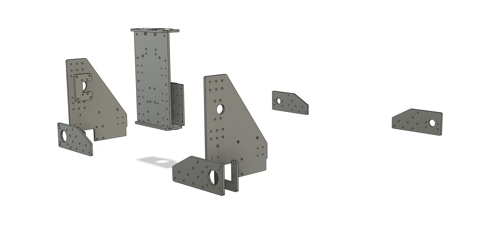
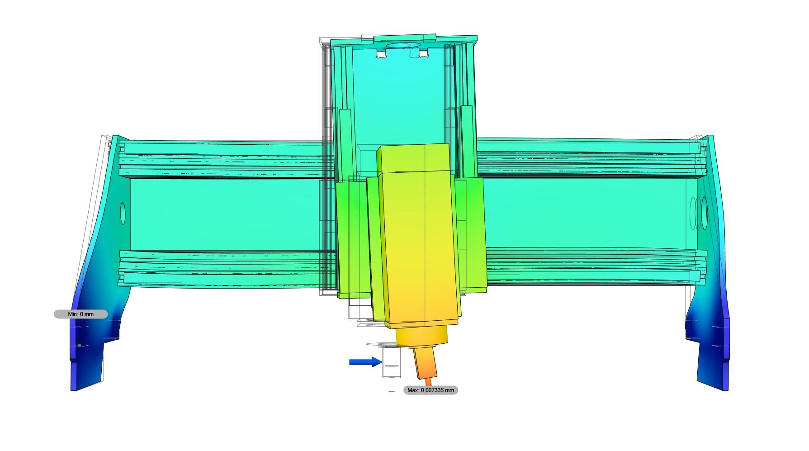

I love the [RepRap](https://en.wikipedia.org/wiki/RepRap_project){:target="_blank"} concept of building machines which can replicate themselves. The Cindymill is designed with this idea in mind: if you already have built one you can manufacture the needed aluminum plates for the next Cindymill. 
However, lately I've had a lot of inquiries from people who don't have access to a CNC milling machine to have their plates milled. And since milling is an expensive manufacturing method, ordering from a commercial supplier can be quite costly. So now there is a redesigned version of the Cindymill with laser cut steel plates!

Rigidity simulations show similar stiffness for a 6 mm steel version and the 10 mm aluminum version, so that's what we're going with. 
Both versions have similar dimensions, use the same [parts](/parts){:target="_blank"} and can be [assembled with the same manual](/assembly){:target="_blank"}. The only differences are individual sets of spacers and screws.
The Github repository is completely updated, there are now separate folders for steel and aluminum versions. [Take a look around and download all files.](https://github.com/culturalheritagedigital/Cindymill){:target="_blank"}

I am in contact with a supplier in Germany who is currently producing a test set, so there will be a possibility to order them (at least if you are in Europe). It will take a few more weeks but if you are interested in a set feel free to <a href= "mailto:cindymill@culturalheritage.digital">send me a message.</a>
If you know a reliable and fair local supplier on your continent (or if you are one) please send me a message, I would love to build a pool where those interested can easily find someone to make a plate set for them.

Happy milling!

<!--  -->
