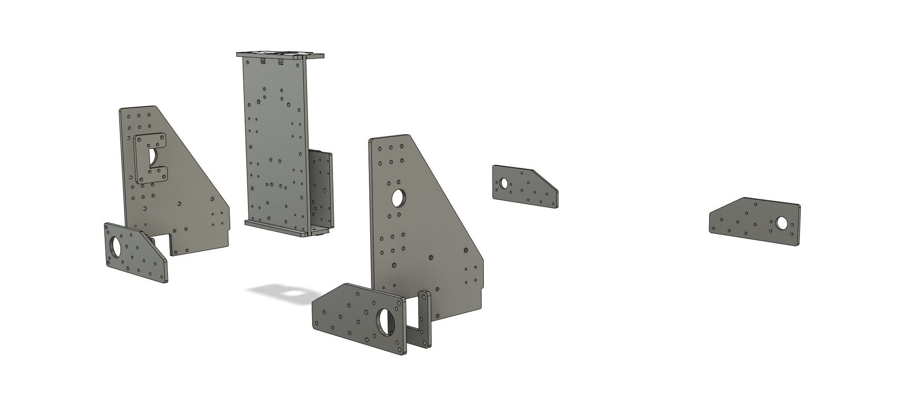
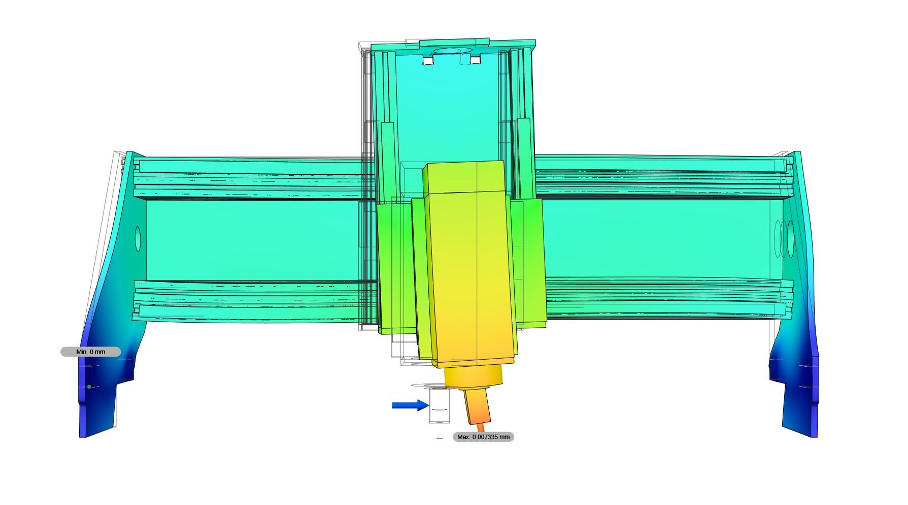

Since American steel suppliers only think in odd fractions, there is now a 1/4" version of the steel plate set. There is also a matching set of spacers, all of which can be downloaded from Github.

[Take a look around and download all files.](https://github.com/culturalheritagedigital/Cindymill){:target="_blank"}

Happy milling!

<!--  -->
